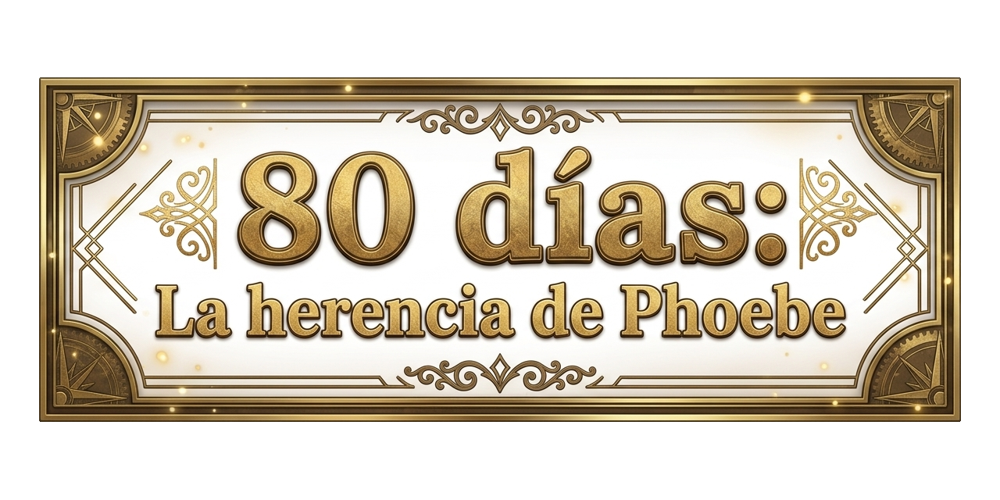

  

# 80 Días · La Herencia de Phoebe

**Phoebe Fogg tiene 80 días para dar la vuelta al mundo… sin avión.**

Esta es una aplicación que simula un viaje alrededor del planeta en tiempo real, inspirada en la novela clásica de Julio Verne, pero ambientado en la actualidad.

La protagonista es **Phoebe Fogg**, una joven que apuesta contra el reloj y recorre el mundo hacia el este eviatando usar vehiculos aereos. Custodia el cuaderno original de bitácora que Phileas dejó en el gabinete de Savile Row, Londres. 

Con **21 años**, decide emprender el mismo viaje hacia el este, sin avión, durante 80 días.

## La Apuesta — Idea de Rohan

La propone **su hermano Rohan**, pero Phoebe sabe que necesita una motivación extra y acepta:

- **Si Phoebe pierde** (no completa la vuelta al mundo en 80 días hacia el este, sin avión), el cuaderno original será propiedad de Rohan, quien pretende entregarlo a la **Universidad de Londres** para saldar su deuda de estudios.
- **Si Phoebe gana**, Rohan debe cederle **de por vida el gabinete de trabajo de Phileas** en Savile Row, donde actualmente tiene su sala de estudios.

La apuesta es **narrativa pura en MVP**: justifica el viaje y da peso a la carta diaria.

---

### ¿De qué va exactamente?

- Viajas de ciudad en ciudad **siempre hacia el Este**.
- Eliges medio de transporte (tren, barco o coche).
- El tiempo de juego es el mismo que el del reloj de tu abuelo, 1 dia de juego es un dia real.
- Phoebe necesita dormir. Si no encuentra un transporte donde dormir (sleeper), tendra que descansar en la proxima ciudad.
- El dinero se va gastando, que sorpresa...
- El clima afecta a los viajes.
- El mapa muestra el día y la noche reales en cada momento y vives en la hora local de la ciudad actual.
- Phoebe escribe cartas contando lo que le va pasando, si, es muy rancia.
- Durante el viaje hay animaciones y musica relajantes que muestran a Phoebe en el vehiculo, la gente a su alrededor, la climatologia, etc. **y cada viaje es diferente**.

Es una mezcla de simulador de viaje, juego de estrategia ligera y experiencia narrativa.
