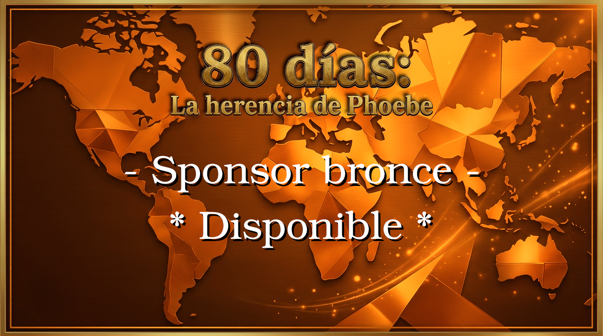
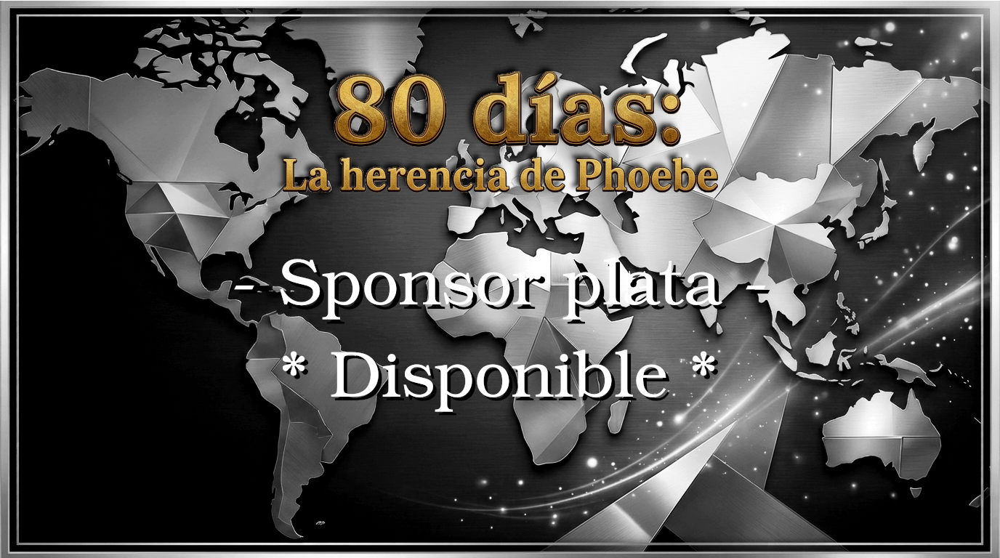
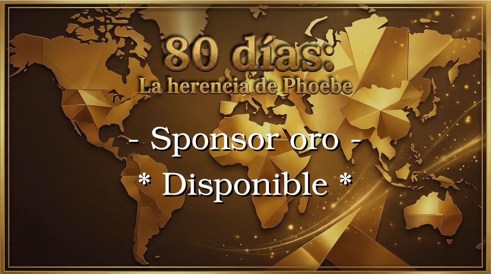

# Propuesta de Esponsorización y Mecenazgo

**Proyecto:** «80 días: la herencia de Phoebe»  
**Desarrollado por:** El Arreglador Studio  

---

Estimado colaborador / inversor,

Le presentamos el programa oficial de esponsorización de **«80 días: la herencia de Phoebe»**, una iniciativa estructurada para dar cabida tanto al apoyo de nuestra comunidad de seguidores como a la inversión estratégica de socios clave y empresas.

A continuación, se detallan los diferentes niveles de aportación y los beneficios asociados a cada uno de ellos:

---

## 2. Nivel Bronce (300€)

* **Público objetivo:** Patrocinadores individuales o entidades que buscan un seguimiento formal y cercano de la evolución técnica del título.
* **Retribución y beneficios:**
  * **Reporte mensual detallado** sobre el estado del desarrollo y el cumplimiento de hitos.
  * Mención nominal destacada en los **créditos generales** del juego.

---

## 3. Nivel Plata (500€)

* **Público objetivo:** Inversores y colaboradores que desean participar activamente en la fase de evaluación y control de calidad.
* **Retribución y beneficios:**
  * **Todos los beneficios del Nivel Bronce.**
  * **Acceso exclusivo a las versiones Beta** del juego para pruebas anticipadas.
  * **Mención destacada** en la sección principal de créditos de la obra.
  * **Visibilidad de producto** el producto o empresa aparece en el juego

---

## 4. Nivel Oro (1200€)

* **Público objetivo:** Socios estratégicos, inversores corporativos o desarrolladores que buscan la máxima implicación en el proyecto.
* **Retribución y beneficios:**
  * **Exclusividad:** Limitado a un único patrocinador global para garantizar una integración única en la obra.
  * **Todos los beneficios del Nivel Plata.**
  * **Co-diseño:** Colaboración en la creación de un elemento puntual dentro del juego (personaje secundario, objeto o detalle narrativo), sujeto a la revisión y aprobación final de la dirección creativa de El Arreglador Studio para garantizar la coherencia del proyecto.
  * **Acceso al código fuente:** Entrega de una copia completa del código fuente del proyecto tras su lanzamiento, bajo licencia de uso personal, educativo o de consulta (sin cesión de propiedad intelectual ni derechos de comercialización).

---

> **Nota aclaratoria:** El programa de esponsorización constituye una figura de mecenazgo y patrocinio. Salvo acuerdo explícito por contrato independiente, no otorga participaciones en la propiedad intelectual del estudio ni derechos sobre la distribución comercial o beneficios económicos derivados de las ventas de la obra.